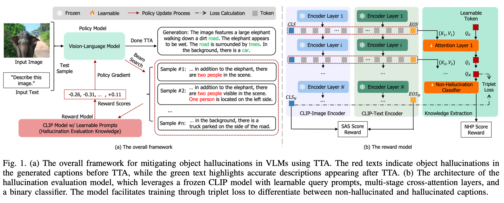
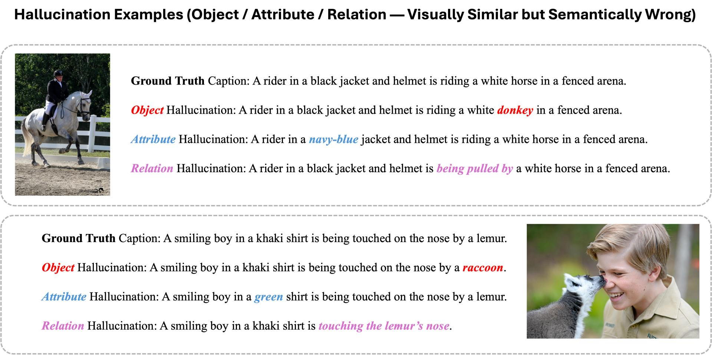

# VisionGuard

### *Test-Time RL for Hallucination Mitigation in Vision-Language Models*

[**Paper (MIPR 2025)**](https://doi.org/10.1109/MIPR67560.2025.00054) · [**Demo**](https://feizhao19.github.io/#project-vlm-hallucination)

VisionGuard is a test-time reinforcement learning system that reduces hallucination in pretrained Vision-Language Models (VLMs) through inference-time self-correction. For each image, the VLM policy samples a group of candidate captions, a learned **verifier** scores them for visual grounding and hallucination, and the policy is updated with group-relative rewards. Only **0.003% of the policy's parameters** (LayerNorm γ) are tuned, and the backbone is never retrained. This lowers the AMBER **hallucination rate by 15.4%** on LLaVA-1.5-7B.

The key finding is a **reward-hacking gap**: CLIP's alignment score alone gives a high reward to a caption that is mostly correct but contains a single localized hallucination. VisionGuard closes this gap with a dedicated **Non-Hallucination Probability (NHP)** signal. Conceptually, the RL formulation (sample a group of candidates, then update the policy with relative rewards) is similar to the RL recipe popularized by [DeepSeek-R1](https://arxiv.org/abs/2501.12948). VisionGuard was proposed and tested before DeepSeek-R1 was published.



---

## Agentic Architecture

VisionGuard decomposes inference into three cooperating roles:

| Role | Component | Responsibility |
|------|-----------|------------------|
| **Policy / Generator** | VLM (LLaVA / InstructBLIP) | Samples a group of caption candidates via beam search |
| **Verifier / Critic** | Frozen CLIP + NHP head | Scores each candidate on semantic alignment (SAS) and non-hallucination probability (NHP) |
| **Self-Corrector** | RL Policy Optimizer | Applies policy-gradient updates to LayerNorm γ, then re-generates |

```
Image + Prompt
     │
     ▼
┌─────────────┐    group of candidates   ┌──────────────────┐
│   Policy    │ ───────────────────────► │    Verifier      │
│   (VLM)     │                          │  SAS + NHP score │
└─────────────┘                          └────────┬─────────┘
     ▲                                            │ group-relative rewards
     │          policy-gradient update            │
     └──────── Self-Corrector (test-time RL) ◄────┘
                    (repeat K steps)
     │
     ▼
  Corrected Caption
```

Each step runs a **generate → verify → update** loop:
1. Sample a group of candidate captions.
2. Score each one with the verifier (SAS + NHP).
3. Update the policy (LayerNorm γ) with group-relative rewards.
4. Repeat for a fixed step budget, then reset the parameters for the next image.

### Synthetic Dataset

To train the NHP verifier, we build a large-scale synthetic dataset from real image–caption pairs. Each correct caption is paired with a version containing a **single or combined** hallucination, generated with **Llama 3.2**, at three levels: **object** (e.g., *horse* → *donkey*), **attribute** (e.g., *black* → *navy-blue*), and **relation** (e.g., *riding* → *being pulled by*). These visually plausible but factually wrong captions are the hard negatives for contrastive (triplet-loss) training. They teach the verifier to separate grounded captions from subtle hallucinations.


*Example from our synthetic dataset: ground-truth captions (black) vs. object / attribute / relation hallucinations (red / blue / pink).*

---

## Key Features

- **Reward-hacking-aware verifier**: the NHP signal closes CLIP's blind spot for localized hallucinations (a further 4.8% reduction).
- **Hallucination mitigation**: reduces the AMBER hallucination rate by **15.4%** (LLaVA-1.5-7B) and **17.3%** (InstructBLIP).
- **Lightweight**: tunes only LayerNorm γ (~0.003% of parameters) in the language backbone.
- **Plug-and-play**: works with off-the-shelf VLMs.
- **Visual-token caching**: encodes each image once with the frozen vision tower and reuses the visual tokens across RL steps.

---

## Limitations

- **No explicit KL penalty.** Drift from the base model is limited implicitly (LayerNorm-only updates, a small step budget, per-image reset) rather than by a KL term.

---

## Repository Structure

```
VisionGuard/
├── visionguard/            # Shared Python package
│   ├── critic/
│   │   └── custom_clip.py  # VisionGuard verifier (CustomCLIPModel)
│   └── vision_cache.py     # Reuse frozen visual tokens across RL steps
├── AMBER/                  # Benchmark evaluation (CHAIR, Cover, Hal, QA metrics)
├── model/
│   ├── blip/               # VisionGuard pipeline for InstructBLIP
│   │   └── TTA_instructBlip.ipynb
│   └── llava/              # VisionGuard pipeline for LLaVA
│       └── TTA_LLaVA.ipynb
├── image/                  # Framework diagram and figures
└── temp/                   # Environment and dataset smoke tests
```

---

## Quick Start

### 1. Environment

```bash
conda env create -f environment.yml
conda activate transformers
```

For AMBER evaluation, also install:

```bash
pip install nltk spacy
python -m spacy download en_core_web_lg
```

### 2. Data & Checkpoints

| Resource | Purpose |
|----------|---------|
| [AMBER](https://github.com/junyangwang0410/AMBER) | Evaluation benchmark (1,004 images) |
| `clipmodel.pth` | Pre-trained VisionGuard verifier weights (not included in this repo; **please contact the authors to obtain the weights**, then place them under the project root or update the path in the notebooks) |
| PixelProse subset | Source image–caption pairs for the synthetic verifier-training data (training script coming soon) |

### 3. Run Self-Correction

Open and run the notebook for your target VLM:

- **LLaVA-1.5-7B:** `model/llava/TTA_LLaVA.ipynb`
- **InstructBLIP-Vicuna-7B:** `model/blip/TTA_instructBlip.ipynb`

Default hyperparameters: `num_steps=5`, `num_beams=5`, `max_new_tokens=512`.

### 4. Evaluate on AMBER

```bash
python AMBER/inference.py \
  --inference_data path/to/visionguard_results.json \
  --evaluation_type g
```

---

## Efficiency: Caching Visual Tokens

Naive test-time RL would re-run the vision encoder on every generate / teacher-forcing pass across `K` RL steps. Because the vision tower (and LLaVA projector) is **frozen**, those continuous visual tokens are identical for a given image, so we compute them **once** and reuse them.

| What we cache | What we do *not* cache |
|---------------|------------------------|
| LLaVA: ViT + projector outputs (visual tokens before the LLM) | LLM K/V for the image prefix across RL steps |
| InstructBLIP: ViT patch embeds | Q-Former (text-conditioned) and LM prefills |

After each LayerNorm update, the image-prefix K/V in the language model becomes stale, so LM prefills still re-run. The helpers live in `visionguard/vision_cache.py` and are wired into both notebooks.

```
per image:
  pixel_values ──► vision tower (+ projector) ──► cached visual tokens   (once)

per RL step:
  cached visual tokens + prompt ──► LM prefill / generate / RL update    (re-run)
```

---

## Supported Models

| Model | HuggingFace ID | Status |
|-------|----------------|--------|
| LLaVA-1.5-7B | `llava-hf/llava-1.5-7b-hf` | Supported |
| InstructBLIP-Vicuna-7B | `Salesforce/instructblip-vicuna-7b` | Supported |

---

## Citation

If you use VisionGuard in your research, please cite:

```bibtex
@inproceedings{zhao2025visionguard,
  author={Zhao, Fei and Zhang, Chengcui and Zhang, Runlin and Wang, Tianyang and Li, Xi},
  booktitle={2025 IEEE 8th International Conference on Multimedia Information Processing and Retrieval (MIPR)},
  title={Mitigating Image Captioning Hallucinations in Vision-Language Models},
  year={2025},
  pages={297--302},
  doi={10.1109/MIPR67560.2025.00054}
}
```

---

## Roadmap

- [x] Cache frozen visual tokens across RL steps (`visionguard.vision_cache`)
- [ ] Extract notebooks into an installable `visionguard` Python package
- [ ] Add YAML configs and CLI entry points
- [ ] Release verifier training code (synthetic hard negatives + triplet loss)
- [ ] Explicit verbal self-correction prompts (generate → critique → revise)
- [ ] Extend to VQA, grounding, and newer VLMs (LLaVA-NeXT, Qwen-VL, Llama 3.2 Vision)

---

## Acknowledgments

1. The [AMBER](https://github.com/junyangwang0410/AMBER) authors for evaluation benchmarks.
2. NVIDIA for GPU resources supporting efficient experimentation.
